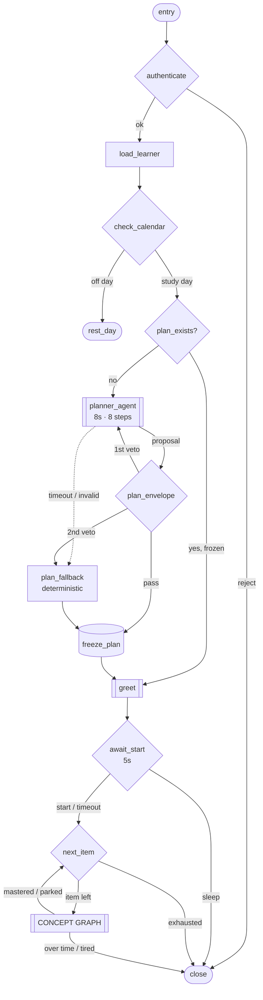
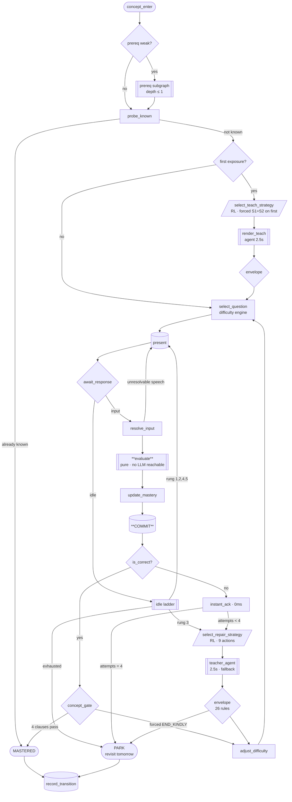
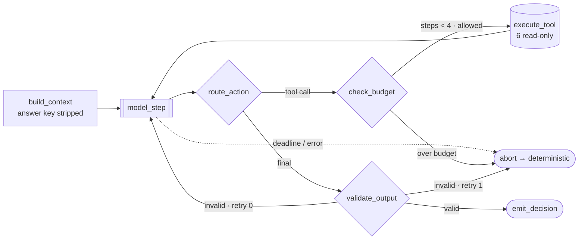

# TEACHING GRAPH — Node & Edge Specification

**Saksham IQ · Executable graph spec for the AI classroom**
**Version:** 1.0 · 2026-08-19 · **Language:** English (implementation reference)
**Companions:** `docs/TEACHING-LOOP-WORKFLOW.md` · `docs/AGENT-FLOW.md` · `docs/AI-100-PERCENT-AUTOMATION.md`
**Visual:** `docs/teaching-graph-visual.html`

---

## 0. What this document is

Everything in the companion docs, restated as **five graphs, 60 nodes and 77 specified edges** — the
form an engineer can implement directly, and the form a graph runtime (LangGraph or plain
Python) can execute.

Nothing here is new policy. This is the same design, expressed as executable structure.

### 0.1 The five graphs

| ID | Graph | Runs | Nodes | Purpose |
|---|---|---|---|---|
| **SG** | Session Graph | once per app open | 15 | entry → plan → lesson loop → close |
| **CG** | Concept Graph | once per concept | 25 | teach → ask → judge → decide → repeat/park |
| **TA** | Teacher Agent | per repair decision | 8 | bounded ReAct loop, ≤4 steps, 2.5 s |
| **PA** | Planner Agent | once per day | 6 | bounded ReAct loop, ≤8 steps, 8 s |
| **ID** | Idle Ladder | per silence timeout | 6 | 5 rungs, only 1 uses an LLM |

`CG` is invoked as a subgraph by `SG`. `TA` and `PA` are invoked as subgraphs by `CG` and `SG`.
`ID` is invoked by `CG`. **Nesting depth is 2. There is no recursion except `CG → CG` for a
prerequisite, which is depth-capped at 1.**

### 0.2 Node taxonomy

Every node carries exactly one type and one owner.

| Type | Meaning | Deterministic? |
|---|---|---|
| `compute` | Pure function over state. No I/O. | Always |
| `io` | Reads/writes Postgres, Redis, or the client. | Always |
| `guard` | Validates and may veto or clamp. Cannot originate a decision. | Always |
| `router` | Evaluates conditions, picks the next edge. No side effects. | Always |
| `agent` | Calls an LLM. Has a deadline and a fallback edge. | Never |
| `policy` | Selects an action from a bounded set using learned values. | Reproducible given the table |
| `terminal` | Graph exit. | Always |

| Owner | Meaning |
|---|---|
| **D** | Deterministic code |
| **A** | LLM agent decides |
| **H** | Agent writes the words, a guard validates them |
| **RL** | Learned policy selects from a bounded action set |

### 0.3 Three invariants the graph structure itself enforces

1. **`CG.evaluate` has no inbound edge from any `agent` or `policy` node.** Correctness is
   unreachable from the model. This is checkable by static graph analysis, not by review.
2. **`CG.commit` precedes every `agent` node on the response path.** The child's truth is
   persisted before any LLM is called; an agent failure can never lose progress.
3. **Every `agent` node has exactly two outbound edges:** success, and `on_fail` to a
   deterministic node. There is no agent node whose failure has no route.

---

## 1. Graph State

One typed object flows through every graph. It maps 1:1 onto the `lesson_states` row plus
request-scoped fields.

```python
from dataclasses import dataclass, field
from typing import Literal, Any

Phase    = Literal["greet","set","teach","ask","listen","judge","branch","close"]
Decision = Literal["ADVANCE","RE_EXPLAIN","SIMPLIFY","PREREQUISITE",
                   "SWITCH_MODALITY","END_KINDLY"]
Strategy = Literal["S1_TELL","S2_SHOW","S3_EXAMPLE","S4_STORY","S5_CONTRAST",
                   "S6_DO_TOGETHER","S7_SENSE_SWITCH","S8_PREREQUISITE","S9_PARK"]

@dataclass
class GraphState:
    # ---- identity (immutable for the run) ----
    child_id: str
    session_id: str
    class_id: str                      # playgroup | nursery | lkg | ukg
    age_band: str
    locale: str                        # en | hi

    # ---- plan (owned by SG) ----
    plan_id: str | None = None
    plan_items: list[dict] = field(default_factory=list)
    plan_cursor: int = 0
    target_minutes: float = 8.0

    # ---- current concept (owned by CG) ----
    skill_id: str | None = None
    topic_id: str | None = None
    phase: Phase = "greet"
    activity: dict | None = None       # authored activity, answer key stripped for agents

    # ---- teaching state (owned by CG) ----
    attempts_on_current: int = 0       # hard cap 4
    strategies_used: list[Strategy] = field(default_factory=list)
    scaffold_level: int = 3            # S0..S4
    modality: Literal["tap","voice","trace"] = "tap"
    difficulty: dict = field(default_factory=dict)   # H1..H6 dial positions
    consecutive_first_try: int = 0

    # ---- learner facts (loaded, never inferred) ----
    mastery: float = 0.0
    mastery_band: Literal["weak","learning","mastered"] = "weak"
    attempts_total: int = 0
    correct_forms: list[str] = field(default_factory=list)   # distinct activity_ids
    correct_days: list[str] = field(default_factory=list)    # distinct ISO dates
    prereq_mastery: dict[str, float] = field(default_factory=dict)

    # ---- session signals ----
    frustration: float = 0.0
    fatigue_band: Literal["fresh","tired"] = "fresh"
    minutes_in_session: float = 0.0
    idle_rung: int = 0
    ai_calls_used: int = 0             # budget 12/session

    # ---- turn-scoped (cleared each turn) ----
    raw_input: dict | None = None
    resolved_answer: str | None = None
    is_correct: bool | None = None
    decision: Decision | None = None
    strategy: Strategy | None = None
    message: str | None = None
    presentation: dict = field(default_factory=dict)
    visual_action: dict = field(default_factory=dict)

    # ---- observability ----
    agent_source: Literal["agent","deterministic_fallback"] = "agent"
    envelope_vetoes: list[dict] = field(default_factory=list)
    diagnosis: str | None = None
    reasoning: str | None = None       # logged, never sent to the child
```

### 1.1 Field ownership

A field is written by exactly one graph. This is what keeps the graphs composable.

| Fields | Written by | Read by |
|---|---|---|
| `plan_*`, `target_minutes` | SG | CG (read-only) |
| `skill_id`, `topic_id`, `phase`, `attempts_on_current`, `strategies_used`, `scaffold_level`, `difficulty` | CG | TA (read-only) |
| `mastery*`, `correct_forms`, `correct_days`, `attempts_total` | `CG.update_mastery` **only** | everything |
| `decision`, `strategy` | `CG.select_repair_strategy` + `CG.envelope` | — |
| `message`, `visual_action` | TA, then clamped by `CG.envelope` | client |
| `is_correct` | `CG.evaluate` **only** | everything |

> **`is_correct` has exactly one writer in the entire system.** If a second writer ever
> appears, that is the bug — not a style issue.

---

## 2. SG — Session Graph

### 2.1 Node catalog

| ID | Name | Type | Owner | Reads | Writes | Budget | On fail |
|---|---|---|---|---|---|---|---|
| `SG.01` | `entry` | io | D | request | `child_id`,`session_id` | 5 ms | 401 |
| `SG.02` | `authenticate` | guard | D | token | — | 10 ms | → `SG.15` |
| `SG.03` | `load_learner` | io | D | db | `mastery`,`prereq_mastery`,`fatigue_band` | 40 ms | → `SG.15` |
| `SG.04` | `check_calendar` | router | D | prefs, date | — | 1 ms | — |
| `SG.05` | `rest_day` | terminal | D | — | — | — | — |
| `SG.06` | `plan_exists` | router | D | `daily_plans` | — | 10 ms | — |
| `SG.07` | `planner_agent` | agent | A | learner facts | plan proposal | **8 s** | → `SG.09` |
| `SG.08` | `plan_envelope` | guard | D | proposal | `plan_items` | 5 ms | → `SG.09` |
| `SG.09` | `plan_fallback` | compute | D | learner facts | `plan_items` | 20 ms | — |
| `SG.10` | `freeze_plan` | io | D | `plan_items` | `plan_id` | 15 ms | → `SG.15` |
| `SG.11` | `greet` | agent | H | memory, plan | `message` | 2 s | template |
| `SG.12` | `await_start` | io | D | — | — | 5 s timer | auto-start |
| `SG.13` | `next_item` | router | D | `plan_cursor` | `skill_id`,`topic_id` | 1 ms | — |
| `SG.14` | `concept_graph` | subgraph | — | → **CG** | outcome | — | — |
| `SG.15` | `close` | terminal | D | outcomes | recap | 30 ms | — |

### 2.2 Edge table

| # | From | To | Condition |
|---|---|---|---|
| 1 | `SG.01` | `SG.02` | always |
| 2 | `SG.02` | `SG.03` | authenticated |
| 3 | `SG.02` | `SG.15` | rejected |
| 4 | `SG.03` | `SG.04` | always |
| 5 | `SG.04` | `SG.05` | `today not in prefs.plan_days` |
| 6 | `SG.04` | `SG.06` | otherwise |
| 7 | `SG.06` | `SG.11` | plan exists for today → **frozen, skip generation** |
| 8 | `SG.06` | `SG.07` | no plan for today |
| 9 | `SG.07` | `SG.08` | proposal returned |
| 10 | `SG.07` | `SG.09` | timeout ∨ invalid ∨ budget exhausted |
| 11 | `SG.08` | `SG.10` | all envelope rules pass |
| 12 | `SG.08` | `SG.07` | **first** veto → one retry |
| 13 | `SG.08` | `SG.09` | second veto |
| 14 | `SG.09` | `SG.10` | always |
| 15 | `SG.10` | `SG.11` | always |
| 16 | `SG.11` | `SG.12` | always |
| 17 | `SG.12` | `SG.13` | `▶` tapped ∨ 5000 ms elapsed |
| 18 | `SG.12` | `SG.15` | `😴` tapped |
| 19 | `SG.13` | `SG.14` | `plan_cursor < len(plan_items)` |
| 20 | `SG.13` | `SG.15` | plan exhausted |
| 21 | `SG.14` | `SG.13` | concept terminal (mastered ∨ parked) → `plan_cursor += 1` |
| 22 | `SG.14` | `SG.15` | `minutes_in_session > target × 1.25` ∨ `fatigue_band == "tired"` |

**Edge 7 is the freeze rule.** A plan is generated once per `(child_id, plan_date)` and read
thereafter. Refresh, re-login and back-navigation all take edge 7. Without it the agent
produces a slightly different plan each time and the child never gets a routine.

**Edge 12 is the only retry in the system.** One retry, then deterministic. Three retries on
an 8-second agent is a 24-second wait for a 3-year-old.

---

## 3. CG — Concept Graph

The core. This is where `A` gets taught.

### 3.1 Node catalog

| ID | Name | Type | Owner | Writes | Budget | On fail |
|---|---|---|---|---|---|---|
| `CG.01` | `concept_enter` | compute | D | `skill_id`, resets turn fields | 1 ms | — |
| `CG.02` | `check_prereq` | router | D | — | 1 ms | — |
| `CG.03` | `prereq_subgraph` | subgraph | — | (recurse, depth ≤ 1) | — | → `CG.04` |
| `CG.04` | `probe_known` | io | D | `is_correct` | 10 ms | → `CG.06` |
| `CG.05` | `first_exposure` | router | D | — | 1 ms | — |
| `CG.06` | `select_teach_strategy` | policy | RL | `strategy` | 2 ms | heuristic |
| `CG.07` | `render_teach` | agent | H | `message`, `visual_action` | **2.5 s** | template |
| `CG.08` | `select_question` | compute | D | `activity`, `difficulty` | 5 ms | — |
| `CG.09` | `present` | io | D | — | 5 ms | — |
| `CG.10` | `await_response` | io | D | `raw_input` | idle timer | → `CG.11` |
| `CG.11` | `idle_subgraph` | subgraph | — | → **ID** | — | → `CG.20` |
| `CG.12` | `resolve_input` | compute | D | `resolved_answer` | 300 ms | retry prompt |
| `CG.13` | **`evaluate`** | compute | **D** | **`is_correct`** | **1 ms** | **cannot fail** |
| `CG.14` | `update_mastery` | compute | D | `mastery`, `correct_forms`, `correct_days` | 1 ms | — |
| `CG.15` | **`commit`** | io | D | persists everything above | **3 ms** | 500 |
| `CG.16` | `route_outcome` | router | D | — | 1 ms | — |
| `CG.17` | `concept_gate` | guard | D | — | 1 ms | — |
| `CG.18` | `instant_ack` | compute | D | `message` (filler) | **0 ms** | — |
| `CG.19` | `select_repair_strategy` | policy | RL | `strategy`, `decision` | 2 ms | heuristic ladder |
| `CG.20` | `teacher_agent` | subgraph | A | → **TA** | 2.5 s | deterministic |
| `CG.21` | `envelope` | guard | D | clamps everything | 2 ms | template |
| `CG.22` | `adjust_difficulty` | compute | D | `difficulty`, `scaffold_level` | 1 ms | — |
| `CG.23` | `record_transition` | io | D | `rl_transitions` | 3 ms | log only |
| `CG.24` | `mastered` | terminal | D | ledger `mastered` | 5 ms | — |
| `CG.25` | `park` | terminal | D | `revisit_queue`, ledger `parked` | 5 ms | — |

### 3.2 Edge table

| # | From | To | Condition |
|---|---|---|---|
| 1 | `CG.01` | `CG.02` | always |
| 2 | `CG.02` | `CG.03` | `min(prereq_mastery.values()) < 0.40` ∧ depth = 0 |
| 3 | `CG.02` | `CG.04` | otherwise |
| 4 | `CG.03` | `CG.04` | prereq subgraph terminal (either outcome) |
| 5 | `CG.04` | `CG.24` | probe correct **and** `mastery ≥ 0.75` → already known, skip teaching |
| 6 | `CG.04` | `CG.05` | otherwise |
| 7 | `CG.05` | `CG.06` | `strategies_used == []` → **force `S1_TELL` then `S2_SHOW`** |
| 8 | `CG.05` | `CG.08` | already taught this session → straight to question |
| 9 | `CG.06` | `CG.07` | always |
| 10 | `CG.07` | `CG.21` | agent returned |
| 11 | `CG.07` | `CG.21` | timeout → template message, `agent_source = fallback` |
| 12 | `CG.21` | `CG.08` | always |
| 13 | `CG.08` | `CG.09` | always |
| 14 | `CG.09` | `CG.10` | always |
| 15 | `CG.10` | `CG.12` | input received |
| 16 | `CG.10` | `CG.11` | `idle_timeout` fired |
| 17 | `CG.11` | `CG.09` | rungs 1, 2, 4 → re-present with more support |
| 18 | `CG.11` | `CG.19` | rung 3 → re-explain (LLM rung) |
| 19 | `CG.11` | `CG.25` | rung 5 exhausted → park |
| 20 | `CG.12` | `CG.13` | resolved |
| 21 | `CG.12` | `CG.09` | `status == "retry"` — unresolvable speech is **not** a wrong answer |
| 22 | `CG.13` | `CG.14` | always |
| 23 | `CG.14` | `CG.15` | always |
| 24 | `CG.15` | `CG.16` | **═══ TRANSACTION BOUNDARY ═══** |
| 25 | `CG.16` | `CG.17` | `is_correct == True` |
| 26 | `CG.16` | `CG.18` | `is_correct == False` |
| 27 | `CG.17` | `CG.24` | concept gate satisfied (§3.3) |
| 28 | `CG.17` | `CG.22` | not yet → harder form, loop |
| 29 | `CG.22` | `CG.08` | always |
| 30 | `CG.18` | `CG.19` | `attempts_on_current < 4` |
| 31 | `CG.18` | `CG.25` | `attempts_on_current >= 4` → **hard cap, no exceptions** |
| 32 | `CG.19` | `CG.20` | always |
| 33 | `CG.20` | `CG.21` | agent returned ∨ timeout (fallback engaged) |
| 34 | `CG.21` | `CG.22` | always |
| 35 | `CG.21` | `CG.25` | envelope forced `END_KINDLY` (attempt cap, rungs exhausted, frustration ≥ 0.75) |
| 36 | `CG.24` | `CG.23` | always |
| 37 | `CG.25` | `CG.23` | always |
| 38 | `CG.23` | *(exit)* | return outcome to `SG.14` |

### 3.3 `CG.17` concept_gate — the predicate

```python
def concept_gate(s: GraphState) -> bool:
    return (
        s.mastery >= 0.75                       # EWMA, decay applied at read
        and s.attempts_total >= 4               # OP-05
        and len(set(s.correct_forms)) >= 2      # two DIFFERENT activities
        and len(set(s.correct_days)) >= 2       # two DIFFERENT calendar days
    )
```

**Why all four clauses exist.** Every playgroup question has exactly 2 options, so one correct
answer is a 50 % coin flip and three attempts reach 87.5 % by chance alone. Requiring four
attempts weighted toward *first-try* correctness (attempt 1 → 1.0, attempt 2 → 0.6,
attempt 3+ → 0.3) drops the chance-only pass rate to **6.25 %**. The two-forms clause defeats
memorising one picture; the two-days clause separates recall from learning.

Drop any clause and the mastery signal becomes noise — and the RL policy in `CG.19` will then
be trained on that noise.

### 3.4 `CG.13` evaluate — the truth node

```
INBOUND EDGES:   CG.12 only
OUTBOUND EDGES:  CG.14 only
OWNER:           activity_evaluators.py — 37 registered types, pure functions
IMPORTS:         must not transitively import app/agents/ or app/ai/
FAILURE MODE:    none — an unregistered type is rejected at server startup
```

Enforced by `tests/contract/test_truth_node_isolation.py`, which walks the import graph by
AST rather than by mocking.

### 3.5 Node `CG.18` instant_ack — why it is a node and not a flag

The child taps a wrong answer. `CG.19` → `CG.20` → `CG.21` takes ≈1.4 s. A 3-year-old
disengages in that silence.

`CG.18` emits a deterministic filler **before** the agent is invoked, at 0 ms:

| `attempts_on_current` | Filler |
|---|---|
| 0 | "Ohho, chalo phir se!" |
| 1 | "Hmm, saath dekhte hain…" |
| 2 | "Koi baat nahi, aasan karte hain…" |

Fillers rotate and are appended to `already_said`, so the repeat guard in `CG.21` also
prevents the filler itself from becoming repetitive. If the agent returns before the filler's
TTS finishes, the filler is cut mid-sentence — which is what a real teacher does.

**Without `CG.18` the agent architecture is not shippable to this age group.**

---
## 4. TA — Teacher Agent Graph (bounded ReAct)

Invoked by `CG.20`. Stateless per turn: state arrives as an argument, a decision leaves as a
return value. **Nothing is persisted inside this graph.**

### 4.1 Node catalog

| ID | Name | Type | Owner | Budget | On fail |
|---|---|---|---|---|---|
| `TA.01` | `build_context` | compute | D | 3 ms | — |
| `TA.02` | `model_step` | agent | A | 600 ms/step | → `TA.07` |
| `TA.03` | `route_action` | router | D | 1 ms | — |
| `TA.04` | `check_budget` | guard | D | 1 ms | → `TA.07` |
| `TA.05` | `execute_tool` | io | D | 15 ms | → `TA.02` with error |
| `TA.06` | `validate_output` | guard | D | 2 ms | → `TA.02` (1 retry) → `TA.07` |
| `TA.07` | `abort_to_deterministic` | terminal | D | 1 ms | — |
| `TA.08` | `emit_decision` | terminal | D | 1 ms | — |

### 4.2 Edge table

| # | From | To | Condition |
|---|---|---|---|
| 1 | `TA.01` | `TA.02` | always |
| 2 | `TA.02` | `TA.03` | model responded |
| 3 | `TA.02` | `TA.07` | deadline 2500 ms ∨ provider error ∨ `ai_calls_used >= 12` |
| 4 | `TA.03` | `TA.04` | response is a tool call |
| 5 | `TA.03` | `TA.06` | response is a final answer |
| 6 | `TA.04` | `TA.05` | `steps < 4` ∧ tool ∈ allowlist |
| 7 | `TA.04` | `TA.07` | `steps >= 4` ∨ tool not in allowlist |
| 8 | `TA.05` | `TA.02` | tool result appended |
| 9 | `TA.06` | `TA.08` | schema valid |
| 10 | `TA.06` | `TA.02` | invalid **and** `retries == 0` → one retry |
| 11 | `TA.06` | `TA.07` | invalid **and** `retries == 1` |

### 4.3 `TA.01` build_context — the single choke point

Every LLM call in the system passes through this node. It is the only place the model's view
of the world is constructed.

```python
INCLUDED                         EXCLUDED (hard)
─────────────────────────────    ──────────────────────────────────────
event, phase, decision           correct_answer          ← R6
ladder rung, scaffold_level      accepted_answers        ← R6
age_band, locale                 child name, DOB, any PII
skill_display_name               other children's data
activity prompt + hint           raw mastery numbers
options_shown                    the choice of what to do — `decision`
analogy / story candidates         and `strategy` are INPUTS, not outputs
attempts_on_current
allowed ui/visual targets
word_limit
already_said[]                   ← powers the repeat guard
```

> The model is told *what was decided* and asked to *say it*. It is never asked what to do.
> That single inversion is what keeps `R1` (the LLM is never a source of truth) structurally
> true rather than aspirationally true.

### 4.4 Tool allowlist — 6 tools, all read-only

| Tool | Returns | Never returns |
|---|---|---|
| `get_turn_context()` | prompt, hint, options, attempts, scaffold | `correct_answer` |
| `get_skill_state(skill_id)` | band, attempts_total, last_attempt_at | raw EWMA |
| `get_prerequisites(skill_id)` | `requires[]`, `confusable_with[]` + their bands | — |
| `get_explanation_history()` | strategies used, exact text already said | — |
| `get_variants(skill_id, kind, locale)` | authored analogies / stories, band-filtered | generated text |
| `get_recent_answers(n=6)` | the child's last answers | correctness key |

**No tool writes.** A confused agent cannot corrupt state — worst case it produces a poor
teaching line, which `CG.21` clamps and the next turn recovers from.

### 4.5 PA — Planner Agent Graph

Structurally identical to TA. Only the parameters differ.

| | TA | PA |
|---|---|---|
| Nodes | 8 | 6 (no `instant_ack` path, no retry-on-tool-error) |
| `max_steps` | 4 | 8 |
| Deadline | 2 500 ms | 8 000 ms |
| Frequency | ~3 × per session | 1 × per child per day |
| Tools | 6 (turn-scoped) | 6 (learner-scoped) |
| Key tool | `get_variants` | `get_candidate_lessons` |
| Fallback | deterministic branch engine | deterministic plan (W3 S1–S6) |

**`get_candidate_lessons` is PA's most important node input.** It returns only topics that are
unlocked, available and class-matched. The agent cannot select a locked topic because it never
sees one. *Constrain the menu, not the diner* — a guard that fires is worse than a choice that
was never offered.

---

## 5. ID — Idle Ladder Graph

Invoked by `CG.11` when `await_response` times out. Thresholds come from
`manifest.experience_modes[*].idle_thresholds_seconds` — never hardcoded.

| ID | Rung | Action | Type | Owner | Returns to |
|---|---|---|---|---|---|
| `ID.01` | 1 | repeat the instruction verbatim | compute | D | `CG.09` |
| `ID.02` | 2 | add authored hint + highlight target | compute | D | `CG.09` |
| `ID.03` | 3 | **re-explain via next strategy** | subgraph | A | `CG.19` |
| `ID.04` | 4 | `demo_tap` — show the tap, do not submit | compute | D | `CG.09` |
| `ID.05` | 5 | offer something easier | compute | D | `CG.09` |
| `ID.06` | — | no response after rung 5 | terminal | D | `CG.25` park |

**Only `ID.03` calls an LLM.** The ladder runs on every screen; if every rung were an agent, a
quiet child would exhaust the 12-call session budget without answering a single question.

---

## 6. Reference implementation

### 6.1 Recommended — plain Python (~120 lines for the whole runtime)

```python
# app/graph/runtime.py
from typing import Callable, Awaitable

NodeFn = Callable[[GraphState], Awaitable[str]]   # returns the next node id

class Graph:
    def __init__(self, nodes: dict[str, NodeFn], entry: str, terminals: set[str]):
        self.nodes, self.entry, self.terminals = nodes, entry, terminals

    async def run(self, state: GraphState, max_hops: int = 40) -> GraphState:
        node, hops = self.entry, 0
        while node not in self.terminals:
            if (hops := hops + 1) > max_hops:
                raise GraphRuntimeError(f"hop limit at {node}")   # cycle backstop
            node = await self.nodes[node](state)
        await self.nodes[node](state)
        return state
```

```python
# app/graph/concept.py — nodes are plain async functions, each returns the next id

async def evaluate(s: GraphState) -> str:
    """CG.13 — the truth node. Imports nothing from app/agents or app/ai."""
    s.is_correct, s.resolved_answer = activity_evaluators.evaluate(
        activity_evaluators.EvaluationInput(
            activity_type=s.activity["type"],
            correct_answer=s.activity.get("correct_answer") or "",
            options=s.activity.get("options", []),
            answer=s.resolved_answer or "",
            accepted_answers=tuple(s.activity.get("accept", [])),
            open_ended=s.activity.get("open_ended", False),
        )
    )
    return "CG.14"

async def route_outcome(s: GraphState) -> str:
    """CG.16 — runs AFTER commit. Pure router, no side effects."""
    return "CG.17" if s.is_correct else "CG.18"

async def instant_ack(s: GraphState) -> str:
    """CG.18 — 0 ms filler, emitted before the agent is invoked."""
    s.attempts_on_current += 1
    await emit_partial(s, filler_for(s.attempts_on_current, s.locale))
    return "CG.19" if s.attempts_on_current < 4 else "CG.25"

async def teacher_agent(s: GraphState) -> str:
    """CG.20 — subgraph with a hard deadline and a guaranteed fallback edge."""
    try:
        s_out = await asyncio.wait_for(TEACHER_GRAPH.run(s), timeout=2.5)
        s.agent_source = "agent"
    except (asyncio.TimeoutError, AgentError):
        deterministic_repair(s)                 # branch engine + heuristic ladder
        s.agent_source = "deterministic_fallback"
        metrics.agent_timeout.labels(agent="teacher").inc()
    return "CG.21"

CONCEPT_GRAPH = Graph(
    nodes={"CG.01": concept_enter, ..., "CG.25": park},
    entry="CG.01",
    terminals={"CG.24", "CG.25"},
)
```

**The transaction boundary is a code structure, not a convention:**

```python
async def step(session_id: str, child_input: ChildInput) -> ConductorDirective:
    async with uow.begin() as tx:                          # CG.10 … CG.15
        s = await repo.lock_lesson_state(session_id)       # SELECT ... FOR UPDATE
        s.raw_input = child_input
        await run_until(CONCEPT_GRAPH, s, stop_after="CG.15")
        await tx.commit()                                  # ═══ TRUTH PERSISTED ═══

    await run_from(CONCEPT_GRAPH, s, start="CG.16")        # CG.16 … CG.23 — agents live here
    return build_directive(s)
```

### 6.2 LangGraph variant — if you want the tracing

Valid for `TA` and `PA` (they are genuine ReAct loops). **Not** for `SG`/`CG`, which own a
database transaction.

```python
from langgraph.graph import StateGraph, END

def build_teacher_graph():
    g = StateGraph(TeacherTurnState)
    g.add_node("build_context",   build_context)
    g.add_node("model_step",      model_step)
    g.add_node("execute_tool",    execute_tool)
    g.add_node("validate_output", validate_output)

    g.set_entry_point("build_context")
    g.add_edge("build_context", "model_step")
    g.add_conditional_edges("model_step", route_action, {
        "tool":  "execute_tool",
        "final": "validate_output",
        "abort": END,
    })
    g.add_edge("execute_tool", "model_step")
    g.add_conditional_edges("validate_output", on_validation, {
        "ok": END, "retry": "model_step", "abort": END,
    })

    return g.compile()          # ← NO checkpointer. See below.
```

> **Compile without a checkpointer.** A turn's agent loop is stateless: state comes from
> Postgres, a decision goes back to Postgres. Adding `PostgresSaver` creates a second store
> for lesson state, and two sources of truth is precisely the bug being removed from the
> client (`TRACK-A` §2). One turn = one stateless invocation.

**Recommendation:** start with plain Python. The runtime above is ~120 lines and the graph is
25 nodes with deterministic edges. Adopt LangGraph when a third agent appears or a loop needs
6+ steps — migrating up is easy, and unwinding a premature dependency is not.

### 6.3 Static checks the graph makes possible

```python
# tests/contract/test_graph_invariants.py

def test_truth_node_isolation():
    """CG.13 must not reach an LLM through any import path."""
    assert not reachable_imports("app.graph.concept.evaluate") & {"app.agents", "app.ai"}

def test_commit_precedes_every_agent():
    """No agent node may be reachable from entry without passing CG.15."""
    for node in nodes_of_type("agent", CONCEPT_GRAPH):
        for path in all_paths(CONCEPT_GRAPH, "CG.01", node):
            assert "CG.15" in path, f"{node} reachable without commit via {path}"

def test_every_agent_has_failure_edge():
    for node in nodes_of_type("agent"):
        assert any(e.kind == "on_fail" and target_is_deterministic(e.to)
                   for e in outbound(node))

def test_no_unbounded_cycle():
    for cycle in find_cycles(CONCEPT_GRAPH):
        assert any(n in {"CG.18", "CG.22"} for n in cycle)   # carries attempt/difficulty counter

def test_attempt_cap_unreachable_past_four():
    assert simulate_worst_case(CONCEPT_GRAPH).max_attempts == 4
```

**This is the real argument for writing the system as an explicit graph:** these five tests
are impossible against a pile of service calls, and trivial against a node/edge table.

---

## 7. Mermaid sources

Paste into any Mermaid renderer, a GitHub README, or your wiki.

### 7.1 Session Graph



### 7.2 Concept Graph



### 7.3 Teacher Agent Graph



---

## 8. Node inventory summary

| Graph | Nodes | `compute` | `io` | `guard` | `router` | `agent` | `policy` | `terminal` |
|---|---|---|---|---|---|---|---|---|
| SG | 15 | 2 | 4 | 2 | 3 | 2 | 0 | 2 |
| CG | 25 | 8 | 6 | 2 | 4 | 1 | 2 | 2 |
| TA | 8 | 1 | 1 | 2 | 1 | 1 | 0 | 2 |
| PA | 6 | 1 | 1 | 1 | 1 | 1 | 0 | 1 |
| ID | 6 | 4 | 0 | 0 | 0 | 1 | 0 | 1 |
| **Total** | **60** | **16** | **12** | **7** | **9** | **6** | **2** | **8** |

| Owner | Nodes | Share | Which |
|---|---|---|---|
| **D** deterministic | 51 | **85 %** | everything else, including all 8 terminals |
| **A** agent decides | 5 | 8 % | `SG.07` `CG.20` `TA.02` `PA.02` `ID.03` |
| **H** agent writes, guard validates | 2 | 3 % | `SG.11` `CG.07` |
| **RL** learned policy | 2 | 3 % | `CG.06` `CG.19` |

**85 % of the graph is deterministic, and every path from entry to any terminal stays
traversable with `LLM_PROVIDER=none`.** Five agent nodes carry the open-ended judgement and
two more carry the teaching voice; each has a failure edge to a deterministic node, so the
graph has no path that *requires* a model to complete.

**Edge count by graph:** SG 22 · CG 38 · TA 11 · ID 6 · PA 11 (mirrors TA) = **77**.

---

## 9. Build order for the graph

| # | Deliverable | Unblocks |
|---|---|---|
| 1 | `GraphState` + `Graph` runtime (~120 lines) | everything |
| 2 | `CG.13` `evaluate` + `CG.14` `update_mastery` + `CG.15` `commit` | the truth spine |
| 3 | `CG.17` `concept_gate` (4 clauses) | trustworthy mastery signal |
| 4 | CG happy path: `CG.01 → CG.09 → CG.10 → CG.16 → CG.24` | a lesson that runs |
| 5 | Deterministic repair: heuristic ladder at `CG.19`, no agent | **baseline + fallback** |
| 6 | `CG.21` `envelope` — 26 rules + veto metrics | prerequisite for any agent |
| 7 | `CG.18` `instant_ack` | makes agents feel instant |
| 8 | `TA` graph + `CG.20` | the teaching voice |
| 9 | `SG` graph + `PA` | scheduling and auto-open |
| 10 | `ID` graph | no dead ends |
| 11 | `CG.23` `record_transition` + nightly RL update | learning from data |
| 12 | Graph invariant tests (§6.3) | keeps all of it true |

**Node 5 before node 8, and node 6 before node 8.** The deterministic repair path is the
fallback for every agent edge and the baseline every agent is measured against; the envelope
is what makes agent output safe to render. Building the agent first means shipping an
unguarded, unmeasurable, un-fallback-able one.

---

*Companions: `docs/TEACHING-LOOP-WORKFLOW.md` (pedagogy and the concept gate rationale) ·
`docs/AGENT-FLOW.md` (decision boundary, envelope rules, cost and latency) ·
`docs/AI-100-PERCENT-AUTOMATION.md` (component-by-component verdicts).*
